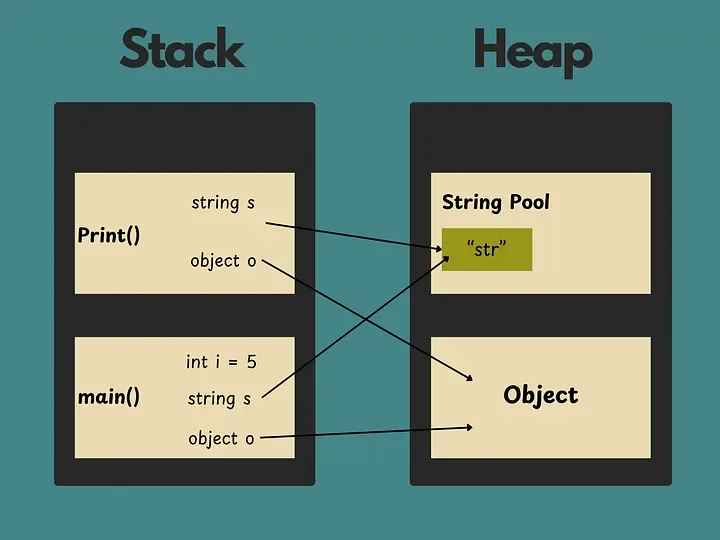
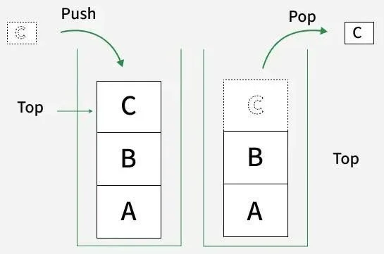
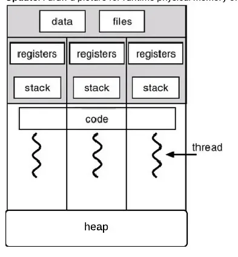
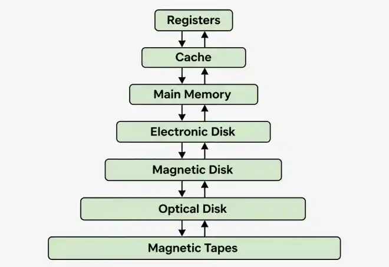
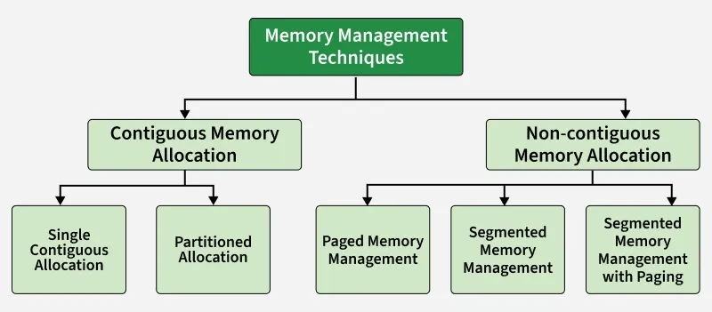

# Heap Double Free Attack

Phân tích lỗi giải phóng cùng một vùng nhớ nhiều lần, làm sai lệch trạng thái quản lý heap và có thể dẫn đến hành vi ngoài dự kiến. Trọng tâm là nguyên nhân, tác động và cách bảo đảm mỗi vùng nhớ chỉ được giải phóng đúng một lần.

## Yêu cầu

- Trình bày khái niệm, nguyên lý và điều kiện phát sinh của lỗ hổng.
- Xác định và giải thích mã CWE tương ứng.
- Nhận diện vị trí lỗ hổng trong mã nguồn hoặc binary và phân tích nguyên nhân gây ra lỗ hổng.
- Liên hệ ít nhất một CVE thực tế có liên quan, bao gồm sản phẩm bị ảnh hưởng, nguyên nhân, tác động, điều kiện khai thác và biện pháp khắc phục. (Phần CVE chỉ yêu cầu nghiên cứu và phân tích thông tin; không bắt buộc reproduce hoặc tái hiện việc khai thác CVE.)
- Giải thích chuỗi khai thác và mối liên hệ giữa lỗ hổng, CWE, CVE và kỹ thuật khai thác.
- Thực hiện demo giải 01 challenge CTF hoặc khai thác 1 lỗ hổng liên quan thuộc mảng Pwnable trong môi trường được cấp phép, cô lập và an toàn bằng 2 hướng: 1/ phương pháp thủ công; 2/ phương pháp có sự hỗ trợ của AI.
- Đề xuất biện pháp khắc phục hoặc phòng ngừa.
- Phân tích các điều kiện, cơ chế bảo vệ và giới hạn ảnh hưởng đến khả năng khai thác thành công.

## Stack và Heap



### Stack

Stack là vùng nhớ lưu biến local, tham số hàm (function parameters) và thông tin về function call (như return addresses).



- Stack hoạt động theo nguyên tắc LIFO — last in, first out (như stack trong cấu trúc dữ liệu).
- Call stack theo dõi các function call: mỗi lần một hàm được gọi, một stack frame được push vào stack; khi thoát khỏi hàm, frame đó được pop ra.
- Dữ liệu trên stack chỉ tồn tại trong thời gian hàm chạy. Stack tự mở rộng và thu hẹp theo lời gọi hàm và khi hàm trả về.
- Khi một hàm trả về, toàn bộ biến stack bị hủy và con trỏ stack (stack pointer) quay về vị trí cũ.
- Bạn không phải tự giải phóng bộ nhớ stack như với heap.
- Con trỏ (pointer) là biến lưu địa chỉ bộ nhớ. Có thể dùng con trỏ để trỏ tới dữ liệu trên stack, nhưng nếu trả về con trỏ tới một biến local thì con trỏ đó sẽ không còn hợp lệ sau khi hàm kết thúc.
- Stack có kích thước cố định do OS quy định (thường vài trăm KB đến vài MB cho mỗi tiến trình).
- Stack overflow xảy ra khi chương trình dùng nhiều bộ nhớ stack hơn mức được cấp.

### Heap



Heap là vùng nhớ lớn dùng cho cấp phát động, chứa dữ liệu mà kích thước hoặc thời điểm xuất hiện chỉ được biết khi chương trình chạy.

- Bạn tự cấp phát bộ nhớ trên heap bằng malloc/free.
- Vòng đời dữ liệu trên heap do người lập trình kiểm soát (hoặc garbage collector, với các ngôn ngữ có cơ chế quản lý bộ nhớ tự động).
- Heap thường lớn hơn stack. Các đối tượng, cấu trúc dữ liệu lớn (như mảng, danh sách liên kết) và dữ liệu cần chia sẻ giữa các hàm hoặc tồn tại lâu hơn một lần gọi hàm đều được lưu trên heap.
- Mỗi thread có stack riêng, nhưng heap dùng chung cho tất cả thread.

## Memory Management in Operating System

Quản lý bộ nhớ trong hệ điều hành là quá trình kiểm soát và tổ chức bộ nhớ máy tính thông qua phân bổ các phần (được gọi là các khối) cho các chương trình thực thi khác nhau, nhằm mục đích cải thiện hiệu suất tổng thể của chương trình.



### Các kỹ thuật phân bổ bộ nhớ



Có 2 nhánh phân bổ bộ nhớ; ở bài này tập trung vào nhánh thứ 2 — Non-Contiguous Memory Allocation.

#### Non-Contiguous Memory Allocation

Là một kỹ thuật quản lý bộ nhớ trong đó tiến trình được chia ra làm nhiều phần nhỏ và lưu ở các vị trí khác nhau trên bộ nhớ chính. Không như contiguous allocation, toàn bộ tiến trình không cần phải nạp vào một ô nhớ đơn liền kề, việc này làm tăng hiệu suất chương trình và giảm tình trạng phân mảnh.

Các kỹ thuật được dùng:

- Paging: Chia một tiến trình thành nhiều trang nhớ (page) có kích thước cố định, bộ nhớ chia thành từng khung (frame) cùng kích thước.
- Segmentation: Chia một tiến trình thành nhiều đoạn logic với kích thước thay đổi, ví dụ: mã lệnh, dữ liệu, stack.
- Segmentation with Paging: kết hợp 2 kỹ thuật trên để giảm phân mảnh.

### Các cơ chế quản lý bộ nhớ

#### Virtual memory

Cho phép chương trình có kích thước lớn hơn RAM vẫn thực thi được, bằng cách dùng không gian ổ cứng như là phần mở rộng.

#### Page Replacement Algorithms (PRA)

Xác định trang nào cần xóa khỏi bộ nhớ khi bộ nhớ đầy.

#### Demand Paging

Chỉ load page khi tiến trình cần bộ nhớ — giảm sử dụng bộ nhớ không cần thiết và các sự kiện I/O.

## How is DATA stored in heap

Trong các hệ điều hành Linux/Unix, khi một tiến trình cần cấp phát bộ nhớ động thông qua các hàm như `malloc()`, `calloc()`, hay `realloc()`, bộ cấp phát bộ nhớ (Heap Allocator — mặc định là `ptmalloc` trong `glibc`) sẽ không chỉ lưu thuần túy dữ liệu người dùng. Thay vào đó, dữ liệu được đóng gói dưới dạng các Heap Chunks.

### Cấu trúc của một Heap Chunk

Mỗi vùng nhớ trên Heap được quản lý theo một cấu trúc chunk bao gồm cả Metadata (thông tin quản lý) và User Data (dữ liệu thực tế):

```text
    Allocated Chunk                      Freed Chunk
+-------------------+                +-------------------+
|     prev_size     |                |     prev_size     |
+-------------------+                +-------------------+
|     size | A|M|P  |                |     size | A|M|P  |
+-------------------+                +-------------------+
|                   |                |        fd         |
|     User Data     |                +-------------------+
|   (Payload Area)  |                |        bk         |
|                   |                +-------------------+
|                   |                |     Unused...     |
+-------------------+                +-------------------+

```

- `prev_size`: Kích thước của chunk liền kề phía trước — chỉ có ý nghĩa khi chunk phía trước đã được giải phóng (free).
- `size`: Kích thước của chunk hiện tại (bao gồm cả phần Header). 3 bits cuối của `size` được dùng làm các cờ trạng thái (Flags):
  - `A` (NON_MAIN_ARENA): Đánh dấu chunk thuộc Arena phụ hay Arena chính.
  - `M` (IS_MMAPPED): Đánh dấu chunk được cấp phát trực tiếp bằng `mmap()`.
  - `P` (PREV_INUSE): Bằng 1 nếu chunk ngay trước đó đang được sử dụng, bằng 0 nếu chunk trước đó đã bị free.
- `fd` (Forward Pointer) & `bk` (Backward Pointer): Chỉ xuất hiện khi chunk đã bị `free()`. Hai con trỏ này biến chunk rảnh thành một nút (node) nằm trong các danh sách liên kết để chờ tái sử dụng.

## Bins & Memory Allocations

Để quản lý và tái sử dụng các khối bộ nhớ rảnh (freed chunks) một cách tối ưu nhất, glibc malloc sử dụng các danh sách liên kết gọi là Bins. Khi người dùng gọi `free()`, chunk bị giải phóng sẽ không lập tức được trả về cho Hệ điều hành, mà được phân loại và đưa vào một trong các danh sách liên kết này tùy theo kích thước và trạng thái.

### Tcache (Per-Thread Cache) Bins

Tcache giảm thiểu hiện tượng nghẽn do tranh chấp khóa (lock contention) trong các ứng dụng đa luồng (multithreaded): trước khi có tcache, các luồng phải dùng chung một vùng quản lý Heap (Arena) và phải chờ đợi nhau khi gọi `malloc()` hoặc `free()`.

Là một cơ chế bộ nhớ đệm cục bộ dành riêng cho từng luồng (thread), được tích hợp vào bộ cấp phát bộ nhớ `ptmalloc` của thư viện chuẩn glibc từ phiên bản 2.26 (phát hành tháng 8/2017) để tối ưu cho các ứng dụng đa luồng.

Cơ chế hoạt động:

- Mỗi luồng sở hữu một cấu trúc tcache riêng.
- Khi luồng giải phóng một khối bộ nhớ nhỏ (nhỏ hơn ~1032 bytes trên kiến trúc 64-bit), khối bộ nhớ này được đưa ngay vào tcache của luồng đó mà không cần lấy lock.
- Khi luồng xin cấp phát bộ nhớ mới (`malloc`), nó sẽ kiểm tra tcache của mình trước tiên. Nếu có sẵn khối bộ nhớ phù hợp, nó sẽ lấy ra sử dụng ngay lập tức với tốc độ truy xuất cực nhanh.

Quản lý các chunk nhỏ (tối đa ~1032 bytes trên 64-bit) bằng danh sách liên kết đơn (LIFO). Mỗi bin chứa tối đa 7 chunks.

### Fastbins

Quản lý các chunk có kích thước nhỏ (mặc định tối đa 128 bytes trên 64-bit, 64 bytes trên 32-bit).

Sử dụng danh sách liên kết đơn (LIFO). Các chunk trong fastbin không bị gộp (coalesce) ngay lập tức kể cả khi nằm cạnh nhau, giúp tăng tốc độ tái cấp phát.

### Unsorted bin

Danh sách liên kết đôi (FIFO).

Khi một chunk bị free (và không rơi vào tcache hay fastbins), nó được tạm đưa vào Unsorted bin. Tại lần gọi `malloc()` tiếp theo, allocator sẽ duyệt qua Unsorted bin để tìm chunk phù hợp, đồng thời phân loại các chunk chưa dùng về đúng Smallbins hoặc Largebins.

### Smallbins

Quản lý các chunk có kích thước nhỏ hơn 512 bytes (32-bit) hoặc 1024 bytes (64-bit).

Danh sách liên kết đôi (FIFO). Tất cả các chunk trong cùng một Smallbin có kích thước hoàn toàn bằng nhau.

### Large bins

Quản lý các chunk có kích thước từ 1024 bytes trở lên (64-bit).

Các chunk trong cùng một Largebin có thể có kích thước khác nhau (nằm trong một khoảng nhất định) và được sắp xếp theo thứ tự kích thước giảm dần để tối ưu cho thuật toán Best-Fit.

## Double free

Đầu tiên, cần biết bản chất lỗ hổng này xuất phát từ đâu:

Giải phóng bộ nhớ nhiều hơn một lần là hành vi không xác định (undefined behavior) và có thể làm hỏng trạng thái cấp phát. Trong glibc (thư viện GNU-C định nghĩa các API tiêu chuẩn, bọc syscall, quản lý bộ nhớ, khởi chạy/kết thúc tiến trình, đa luồng POSIX, sockets...), các bước kiểm tra và đường khai thác phụ thuộc vào phiên bản glibc, bin, chunk size và các cơ chế giảm thiểu rủi ro. Mẫu fastbin dup (duplication) cơ bản là `free(a); free(b); free(a)`: Fastbin ở các phiên bản cũ chỉ kiểm tra và loại bỏ bản trùng ở đầu danh sách, nên các lần `free` xen kẽ vẫn có thể thỏa mãn các bước kiểm tra. Đây không phải là cách bypass tổng quát — tcache có cơ chế phát hiện trùng lặp riêng, và các bản glibc mới còn dùng safe-linking cho singly linked list.

Bây giờ, khi bạn yêu cầu một vùng nhớ mới thông qua malloc, bộ cấp phát có thể trả về chính vùng nhớ đã được giải phóng hai lần. Điều này dẫn đến hai con trỏ cùng trỏ về một vùng nhớ. Nếu attacker kiểm soát được một trong hai con trỏ thì coi như kiểm soát cả vùng nhớ đó, dẫn tới nhiều hệ lụy như chèn malware hoặc thực thi shellcode.

### Điều kiện phát sinh

- **Cốt lõi:** `free()` được gọi hai lần lên cùng một địa chỉ, và giữa hai lần đó vùng nhớ không được cấp phát lại — tức con trỏ không bị set NULL sau `free()`, hoặc có hai con trỏ alias cùng trỏ về một vùng nhớ.
- **Các mẫu code điển hình:**
  - hai con trỏ alias: `p = q = malloc(...); free(p); free(q);`
  - nhánh xử lý lỗi đã `free()`, rồi nhánh cleanup chung `free()` lại
  - copy nông (shallow copy) struct/object chứa con trỏ
  - `free()` xong không NULL hóa → destructor/cleanup gọi lần hai
  - use-after-free (CWE-416) dẫn tới `free()` lần nữa
  - `realloc` hỏng rồi `free()` cả con trỏ cũ lẫn mới
  - đa luồng: hai thread cùng `free()` một object, hoặc sai refcount
- **Lọt qua allocator:** không phải mọi lần free trùng đều bị chặn — phụ thuộc phiên bản glibc (bảng bên dưới).
- **Nguyên nhân gốc:** quyền sở hữu vùng nhớ không rõ ràng hoặc không được quản lý tại một chỗ duy nhất.

**Free trùng có lọt qua allocator hay không, theo phiên bản glibc:**

| glibc | Kiểm tra của allocator | Hành vi free trùng | OS tiêu biểu |
| --- | --- | --- | --- |
| ≤ 2.25 | Chưa có tcache; fastbin chỉ so phần tử đầu danh sách | Lọt nếu free xen kẽ: `free(a); free(b); free(a)` | CentOS 7 (2.17), Ubuntu 16.04 (2.23), Debian 9 (2.24) |
| 2.26 – 2.28 | Có tcache nhưng chưa kiểm tra trùng lặp | `free(a); free(a)` lọt ngay (tcache dup) | Ubuntu 18.04 (2.27), RHEL 8 (2.28), Debian 10 (2.28) |
| 2.29 – 2.31 | tcache kiểm tra `key` + duyệt list | Phải ghi đè `key` (qua UAF) hoặc lấp đầy tcache bin cho chunk rơi xuống fastbin, rồi free xen kẽ | Ubuntu 20.04 (2.31), Debian 11 (2.31) |
| ≥ 2.32 | Thêm safe-linking cho `fd` của fastbin/tcache | Vẫn lọt như trên, nhưng giả mạo `fd` cần heap leak | RHEL 9 (2.34), Ubuntu 22.04 (2.35), Debian 12 (2.36), Ubuntu 24.04 (2.39) |

Ghi chú:

- tcache có từ glibc 2.26: mỗi bin giữ tối đa 7 chunk (chunk ≤ `0x410`), tắt được bằng `GLIBC_TUNABLES=glibc.malloc.tcache_count=0`.
- Safe-linking chỉ mã hóa/kiểm tra con trỏ `fd`, **không** chặn double free.
- Chunk trong ví dụ bên dưới (`BUFSIZE2 = 248` → chunk `0x100`) nằm trong tcache (glibc ≥ 2.26), không phải fastbin (fastbin 64-bit chỉ tới `0x80`).

Ví dụ:

```c
#include <stdio.h>
#include <stdlib.h>
#include <string.h>

#define BUFSIZE1    512
#define BUFSIZE2    ((BUFSIZE1/2) - 8)

int main(int argc, char **argv) {
  char *i;
  char *h;
  char *j;

  i = (char *) malloc(BUFSIZE2);
  h = (char *) malloc(BUFSIZE2);

  free(i);
  free(h);

  j = (char *) malloc(BUFSIZE1);
  strncpy(j, argv[1], BUFSIZE1-1);

  free(h);
  free(j);
}
```

Trước tiên, `free(i)` và `free(h)` giải phóng hai chunk kích thước `BUFSIZE2` (< `BUFSIZE1`). Tiếp theo, `malloc(BUFSIZE1)` cấp phát `j`: vì `BUFSIZE1` lớn hơn hẳn nên `j` được lấy ở vùng khác (top chunk hoặc unsorted bin), hai chunk trong free list vẫn còn nguyên. Sau đó, `free(h)` lần thứ hai không bị phát hiện, khiến free list bị lặp — cùng một chunk xuất hiện hai lần:

```
h → i → h
```

## Tcache poisoning

Như đã đề cập ở phần trước, với bản patch mới của tcache, ta không thể dùng cách đơn thuần (free xen kẽ) để thực hiện double free attack. Ở phần này mình sẽ giới thiệu hướng mới để bypass vấn đề trên.

Một freed tcache chunk được dùng lại tại một `tcache_entry`:

```c
struct tcache_entry {
    struct tcache_entry *next;
    uintptr_t key;
};
```

Dễ thấy mỗi lần free xong, qword đầu tiên của dữ liệu người dùng sẽ trở thành con trỏ của singly linked list (sll) và qword sau được dùng làm double free check. Nếu lỗ hổng cho phép chúng ta ghi đè lên 1 trong 2, thường biến thành:

- Arbitrary allocation bằng cách làm hỏng `next`.
- Double-free bypass bằng cách làm hỏng `key` ← trọng tâm phần seminar của chúng ta.

## Tài liệu tham khảo

- Blog cá nhân — Learning Malware for Beginner (Part 1): https://nhan-laptop.github.io/posts/malware-binary/learning-Malware-for-beginner-part-1.html
- HackTricks — Double free: https://hacktricks.wiki/en/binary-exploitation/libc-heap/double-free.html
- OWASP — Doubly freeing memory: https://community.owasp.org/vulnerabilities/Doubly_freeing_memory
- HackTricks — Bins & memory allocations: https://hacktricks.wiki/en/binary-exploitation/libc-heap/bins-and-memory-allocations.html#bins--memory-allocations
- GeeksforGeeks — Memory Management in Operating System: https://www.geeksforgeeks.org/operating-systems/memory-management-in-operating-system/
- HackTricks — Tcache bin attack: https://hacktricks.wiki/en/binary-exploitation/libc-heap/tcache-bin-attack.html
